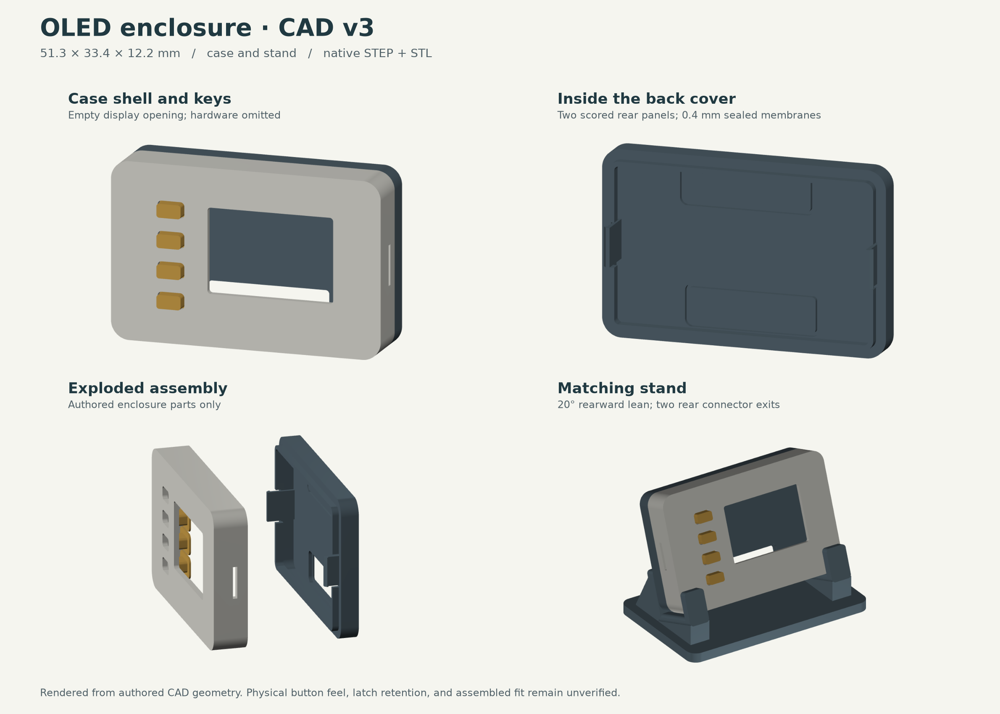
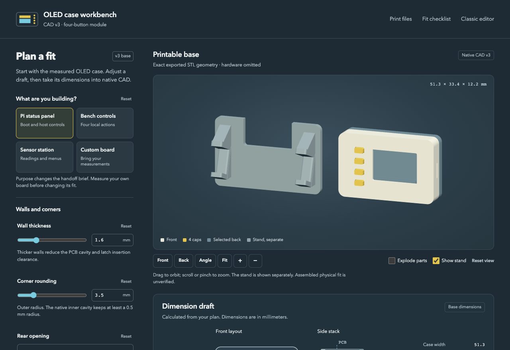
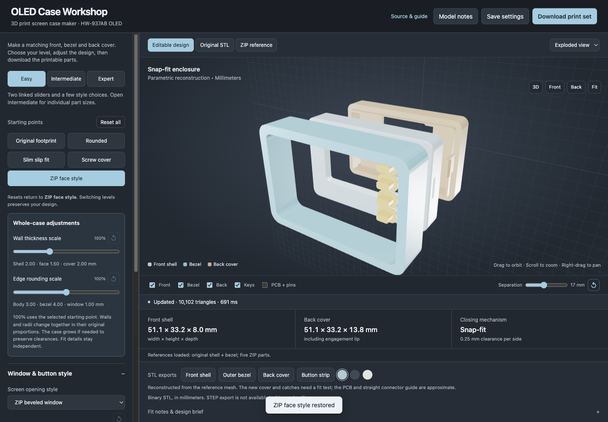

# Pi 500 OLED panel

A seven-page status dashboard and Desktop/Headless boot chooser for a Raspberry
Pi 500 with an HW-937AB SSD1315 128×64 OLED and four buttons.

This repository includes the screen software, a browser case designer, and the
native CAD v3 case and stand. The standalone software has been physically tested
on a Pi 500. CAD v3 is an assembled-fit prototype: valid geometry and successful
slicing do not yet establish fit with the board installed.

- Home, Network, Compute, Thermal, Power, Storage, and Workload pages, with
  scrollable details for long values.
- Current desktop state, this boot's choice, and the saved boot default shown
  separately.
- Start/stop Desktop, reboot, shutdown, and saved-default controls with a fresh
  two-second confirmation hold.
- A bounded startup chooser that falls back to Desktop on hardware or selector
  failure, plus a screen that blanks after 60 seconds without input.
- Optional system-service or HTTP(S) application monitoring; PMIC rail voltages
  with unavailable readings labeled explicitly.

**Supported hardware:** Raspberry Pi 500 with the wiring below. Hardware access
and installation check the Pi model and reject other models. Physical validation
used Raspberry Pi OS based on Debian 13 (Trixie), Python 3.13, and LightDM.
Other boards, OLED variants, and display managers have not been validated.

## Start here

| What you need | Guide or download |
| --- | --- |
| How the hardware and software fit together | [Hardware and software guide](docs/hardware-and-software.md) |
| Exact purchased module, alternatives, and wire count | [Sourcing and board variants](docs/hardware-sourcing.md) |
| Button depth, mounting screws, rear connectors, and fit checks | [Fitment notes](docs/fitment.md) |
| Matching native STL / STEP / Bambu project | [CAD v3 kit](mechanical/cad-rebuild/README.md), [complete ZIP](mechanical/cad-rebuild/OLED-case-CAD-v3-public.zip) |
| Native parts, fit planning, and an agent handoff | [Live workbench](https://oled-case-workshop.annonable.chatgpt.site), [offline ZIP](maker-workbench/oled-maker-workbench.zip) |
| Broader browser case design with custom STL export | [Classic editor](https://oled-case-workshop.annonable.chatgpt.site/classic.html), [offline ZIP](case-playground/oled-case-workshop.zip) |
| What “App Not configured” means and what to build next | [Companion application plan](docs/companion-app-plan.md) |
| A future Printables / MakerWorld listing | [Model posting kit](docs/model-posting.md) |
| People, AI tools, references, and library notices | [Credits](CREDITS.md) |



The development version includes optional [PanelBridge startup controls](docs/panelbridge.md)
for a wireless desktop monitor. This integration has software tests and rendered
previews; deployment and physical validation are pending. Standalone operation
keeps the seven pages and existing boot choices below.

Follow [setup and recovery](docs/setup.md) for complete installation commands,
from a fresh Pi through foreground checks, staged installation, and a supervised
reboot. Read [validation and limitations](docs/validation.md) for the evidence
behind this release and a checklist for your own device.

Use a source checkout or source archive for deployment: the wheel contains the
Python application and artwork; the source distribution also includes the
installer, configuration example, tests, case tools, native CAD kit, and guides.
The existing [v0.1.0 release](https://github.com/aarzamen/pi500-oled-panel/releases/tag/v0.1.0)
retains its original standalone source and assets; use current `main` for the
combined hardware package and development documentation.

## Native case and stand

[CAD v3](mechanical/cad-rebuild/README.md) starts from the community PCB reference
and the builder's button and mounting measurements. Its 51.3 × 33.4 × 12.2 mm body
provides more depth for the buttons, independent retained caps, and rear header
panels at both opposite positions. Choose an intact dual-knockout back or one of
two already-open backs. Straight DuPont connectors exit through the backplate.

The kit includes six STL parts, individual native STEP solids, an enclosure-only
STEP assembly, portable editable CAD source, rendered previews, a two-plate Bambu
Studio project, and validation receipts. Print four copies of the cap and one
chosen back. The public Bambu project has normal cooldown and filament unload.
See the [fitment notes](docs/fitment.md) before printing.

## 3D print screen case maker

**[Open OLED case workbench](https://oled-case-workshop.annonable.chatgpt.site)**
to inspect and download the matching native case parts, plan a measured variant,
or prepare a coding-agent handoff. Start with wall width and rounding, then open
board, mounting and detail controls as needed. Pi status, bench-control and sensor
station purposes suggest projects without claiming additional firmware support.

The 3D preview and STL/STEP downloads use the published CAD v3 base. Planning
controls update the dimension sketch, stack checks and handoff; custom dimensions
need regeneration with the native source. The handoff includes those parameters,
critical measurements and fit trouble areas. Every field and the full plan have
reset controls. See [workbench source and offline files](maker-workbench/README.md).



**[Open the classic OLED Case Workshop](https://oled-case-workshop.annonable.chatgpt.site/classic.html)** to design a printable enclosure for the
HW-937AB OLED module directly in the browser.

- Choose Easy, Intermediate, or Expert controls, with individual and whole-preset resets.
- Resize the shell, back cover, bezels, rounded edges, and screen/button openings.
- Adjust PCB standoff outside diameter and screw-hole diameter independently.
- Position a rear opening for straight DuPont connectors.
- Choose snap-fit, slip-fit, or screw-fastened covers, plus integral tabs or a
  separate rounded button strip.
- Export separate STL files and save or reload the design settings.

See the [case-making guide](docs/case-workshop.md),
[workshop source and offline app](case-playground/README.md), and
[downloadable workshop package](case-playground/oled-case-workshop.zip).
The generated cases need physical fit and button-travel checks; software mesh
validation does not establish a successful print or hardware fit.



The workshop preserves the earlier polygonal design and reference meshes. It
exports **STL** and does not regenerate CAD v3. Use the native kit for **STEP**
and the newer measured button stack. Their dimensions and parts are separate.

## Wiring

Shut down and disconnect power before connecting or removing wires. Check the
module's pin labels and confirm the GPIO pins are free of other users.

| OLED pin | Pi physical pin | BCM signal / control |
| --- | ---: | --- |
| VCC | 1 | 3.3 V |
| GND | 6 | Ground |
| SDA | 3 | GPIO2 / I2C data |
| SCL | 5 | GPIO3 / I2C clock |
| K1 | 11 | GPIO17 / Up |
| K2 | 13 | GPIO27 / Down |
| K3 | 15 | GPIO22 / Select |
| K4 | 16 | GPIO23 / Back and actions |

The tested module uses bus 1, address `0x3c`, active-low buttons with pull-ups,
and gpiochip 0. Confirm these on your hardware before enabling the buttons.
The OLED has a fixed yellow top band and blue lower band; the image itself is
monochrome.

## Controls

| Context | K1 / K2 | K3 | K4 |
| --- | --- | --- | --- |
| Main page | Previous / next page | Open details | Open actions |
| Details | Previous / next main page | Advance field or wrapped text | Return to page |
| Actions | Move selection | Choose item | Back / cancel |
| Confirmation | — | Release, then hold for two seconds | Cancel |
| Startup chooser | Change choice, pause countdown | Confirm choice | Use saved default |

The first press after the display blanks only wakes it. Stopping Desktop ends
graphical applications; keep background work in independent system services.
An accepted action is a queued request: use the Home page to observe the result.

## Startup


George appears for two seconds using the original, unchanged 128×64 artwork.
The chooser then gives eight seconds to accept the saved default (initially
Desktop). Navigation pauses that countdown. At 30 seconds overall, an
unconfirmed choice returns to the saved default. Startup-held keys must be
released before they count as a press.

Systemd limits the selector to 32 seconds plus up to two seconds of cleanup.
Hardware, configuration, rendering, or cleanup failure allows Desktop. A
Headless choice closes the boot splash and leaves the text console available.
Start Desktop clears the temporary Headless marker without repeating the
chooser. The existing graphical boot target and login policy are retained.

## Configuration

Copy `config.example.json` to `config.local.json` before setup. It contains the
tested wiring. With `workload: null`, “App Not configured” is expected. To select
a monitor before installation, use one of these values:

```json
"workload": {"type": "service", "name": "example.service"}
```

```json
"workload": {"type": "endpoint", "url": "http://127.0.0.1:8080/health"}
```

Service “Ready” means the system service is running; use an endpoint for an
application health check. PMIC rail voltages are not total input watts. Total
input power is unavailable without an appropriate measurement source.

That label means an optional monitor has no selected target. It does not mean
the OLED software is missing. A future companion can supply actual job progress,
backup results, or device status. The [implementation plan](docs/companion-app-plan.md)
describes its local status feed and the OLED changes required to read richer data.

Installation copies configuration into `/etc/oled-panel/device.json` and sets
the initial saved default to Desktop. Later edits to the source configuration
do not update the installed copy. Use the OLED Boot Default menu for supported
saved-default changes; see the setup guide before other configuration changes.

## Software development and previews

With `uv` installed, run this in Bash on a development computer. These commands
use a separate Python 3.12 environment and do not access display hardware:

```bash
PROJECT="$HOME/pi500-oled-panel"
git clone https://github.com/aarzamen/pi500-oled-panel.git "$PROJECT"
cd "$PROJECT"
uv venv --python 3.12 .venv
uv pip install --python "$PROJECT/.venv/bin/python" -e "$PROJECT"
"$PROJECT/.venv/bin/python" -m unittest discover -v
"$PROJECT/.venv/bin/python" -m oled_panel.app --preview-dir "$PROJECT/previews" --config "$PROJECT/config.example.json"
"$PROJECT/.venv/bin/python" -m hardware_check --preview "$PROJECT/previews/diagnostic.png"
uv build
```

The preview uses documentation-only example addresses. `--snapshot` instead
prints live, read-only metrics from the computer running it, including network
addresses; review that output before sharing it.

## License

[MIT](LICENSE), copyright 2026 Aaron Arzamendi, for original project source,
case/stand geometry, and documentation. See [credits and provenance](CREDITS.md).
Embedded libraries retain their [notices](case-playground/THIRD-PARTY-NOTICES.txt).
Supplied reference meshes retain their separate, currently unverified provenance;
the project license does not grant a license to those reference assets.
The Bambu-derived CAD print settings retain their
[upstream license notice](mechanical/cad-rebuild/source/profiles/README.md).
