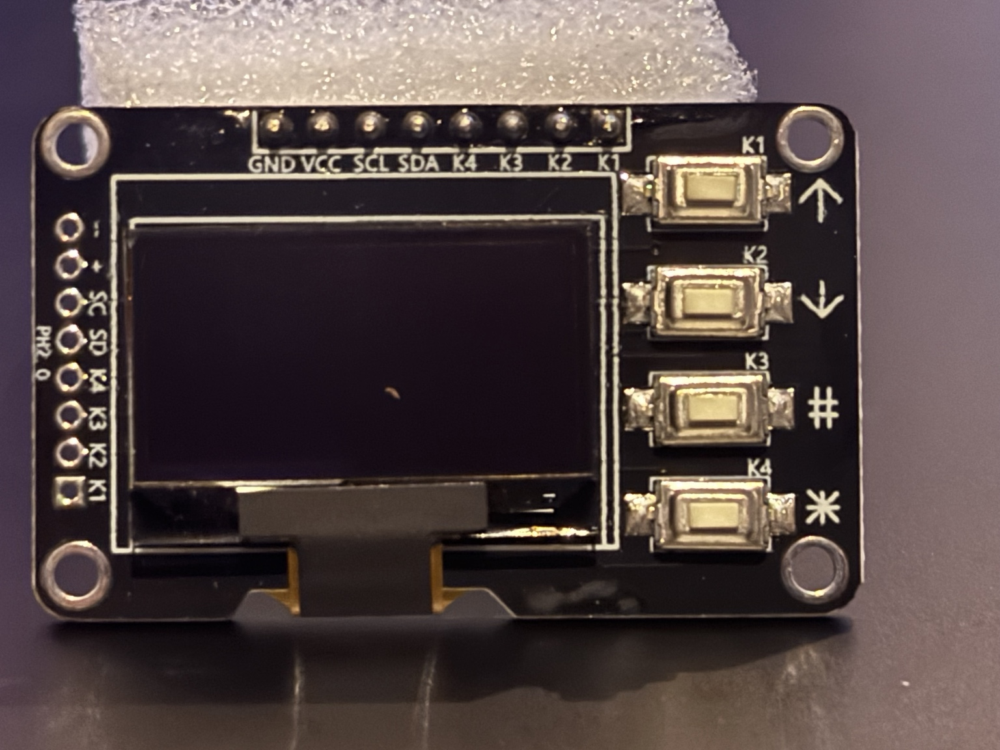

# Hardware and software guide

The Pi 500 OLED Panel has three parts: the Pi status software, the display module
and its wiring, and a printable enclosure. This repository keeps their source,
tools, measurements, and validation records together.

## Choose the right starting point

| Component | What exists | Validation boundary |
| --- | --- | --- |
| Standalone Pi 500 runtime | Seven pages, four buttons, George startup artwork, Desktop/Headless chooser, system actions, recovery tools | Physically tested on one Pi 500 and HW-937AB module; see [validation](validation.md) |
| Browser case workshop | Live and offline editor, tiered controls, resets, bezels, alternative closures, STL export | Mesh and browser checks; each generated design needs a print and fit check |
| Native CAD v3 | Measured button stack, matching case/stand, dual rear knockouts, STL and native STEP | Geometry and actual software slicing checked; assembled physical fit pending |
| Companion application | Proposed local status service and OLED reader extension | [Plan only](companion-app-plan.md); no companion installed by this package |
| PanelBridge extension | Optional development source for same-host monitor controls | Rollout parked; see [its guide](panelbridge.md) before any future integration |

The physical board was purchased as the [ACEIRMC SSD1315 five-pack](https://www.amazon.com/dp/B0GWQPY2C7).
Similar-looking boards are not interchangeable by screen diagonal alone. Read
[sourcing](hardware-sourcing.md) and [fitment](fitment.md) before ordering or printing.

## Connect the module

Follow the complete [setup and recovery guide](setup.md). Shut down and disconnect
Pi power before changing GPIO wiring. The tested module's pressed buttons connect
to ground and use input pull-ups.

| Module | Pi physical pin | Function |
| --- | ---: | --- |
| VCC | 1 | 3.3 V |
| GND | 6 | Ground |
| SDA | 3 | GPIO2 / I2C data |
| SCL | 5 | GPIO3 / I2C clock |
| K1 | 11 | GPIO17 / Up |
| K2 | 13 | GPIO27 / Down |
| K3 | 15 | GPIO22 / Select |
| K4 | 16 | GPIO23 / Back and actions |

This is eight conductors: four for the I2C display and four for the independent
keys. The tested display uses bus 1 and address `0x3c`. Confirm board pin labels,
button polarity, bus/address and GPIO availability on your own module. Mechanical
compatibility with another computer does not extend the runtime's Pi 500 support.

## Install and use the screen software

The [setup guide](setup.md) covers dependencies, foreground diagnostics, staged
installation, supervised boot, and uninstall. Its installer records backups and
digests in a root-owned manifest. Follow that recovery procedure for an installed
system; rerunning the installer is not an upgrade method.

George's original monochrome image appears before the bounded Desktop/Headless
chooser. The dashboard then presents Home, Network, Compute, Thermal, Power,
Storage and Workload. K1/K2 change pages, K3 opens details, and K4 opens actions or
returns. After idle blanking, the first press wakes the screen; release it before
navigation. Power and desktop actions require the confirmation hold described in
the [root README](../README.md).

`App Not configured` is normal with `"workload": null`. The existing monitor can
check a named system service or an HTTP health endpoint. It does not parse a JSON
body or discover installed apps. The [companion plan](companion-app-plan.md)
defines a future source of job progress, backup and device information, with a
separate OLED reader change for those details.

## Make the enclosure

For the measured current prototype, use the [native CAD v3 kit](../mechanical/cad-rebuild/README.md).
It contains one front, three alternative backs, a cap to print four times, and a
matching stand. Individual STEP files preserve native solids. Its assembly STEP
contains the enclosure only; the community hardware STEP stays separate because
its redistribution terms have not been established.

Fit the caps from inside, fit and screw down the PCB, then close the cover. Open
the rear panel needed for straight DuPont connectors, or use an already-open back.
Both opposite panel positions are available. No top-wall cable hole is required.
Check the buttons and latches **with the board and connectors installed**. Use
the [fitment checklist](fitment.md) to record the result.

For broader shape experiments, use the [live workshop](https://oled-case-workshop.annonable.chatgpt.site)
or its [offline ZIP](../case-playground/oled-case-workshop.zip). It has Easy,
Intermediate and Expert controls, per-field resets, bezels, curved edges, and
snap/slip/screw closures. It preserves an earlier design with provisional board
dimensions; its generated parts and defaults differ from native CAD v3.
The workshop exports STL. Native CAD v3 supplies STEP separately.

## Source and downloads

- [Runtime source](../oled_panel), [configuration example](../config.example.json),
  [installer](../system), and [software tests](../tests).
- [Native kit ZIP](../mechanical/cad-rebuild/OLED-case-CAD-v3-public.zip),
  [parameters](../mechanical/cad-rebuild/source/parameters.json),
  [portable generator instructions](../mechanical/cad-rebuild/source/README.md).
- [Workshop source and verification](../case-playground/README.md),
  [case-making guide](case-workshop.md).
- [Printables/MakerWorld draft](model-posting.md), [credits](../CREDITS.md).

A current Git checkout or newly built source distribution includes these tools
and assets. The Python wheel contains the runtime and George artwork only.
The existing v0.1.0 release remains the standalone software release. This hardware
publication changes documentation and packaging, without deploying to a Pi or
sending a print.
