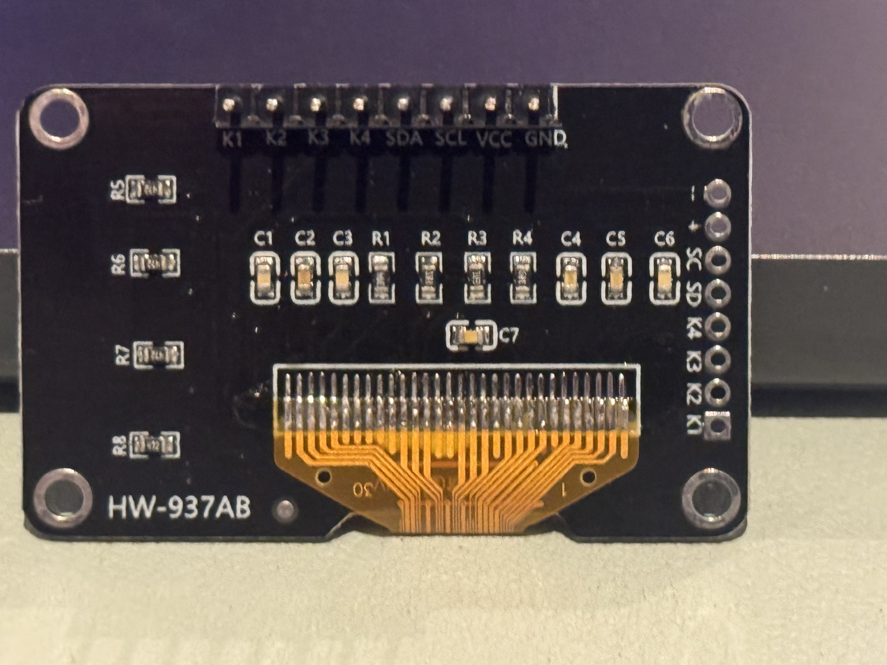

# Module sourcing and board variants

Recorded 2026-10-14. These links identify the builder's source and one candidate
he asked about. Listings can change; confirm the actual board before relying on
a description, photo, or model name.

## Purchased and tested source

The builder identified [Amazon ASIN B0GWQPY2C7](https://www.amazon.com/dp/B0GWQPY2C7)
as the source of the current module. At review, the brand is ACEIRMC and the
listing describes five 0.96-inch, 128×64, SSD1315 yellow/blue displays with four
keys. It specifies 3.3 V, IIC display communication, independent K1–K4 key
interfaces, eight single-row pins at 2.54 mm pitch, and a 44.53 × 27.66 mm module.

The tested physical board is marked **HW-937AB**. Its front header labels are
GND, VCC, SCL, SDA, K4, K3, K2 and K1; follow the labels rather than cable colors.
The user verified the display and all four independent ground-switching buttons
on a Pi 500. The runtime's `ssd1315` driver was used for that test.

The source link identifies the purchased product. It does not establish that
every future item sold under the ASIN has identical mechanical or electrical
details. The seller's outline and the rough community CAD outline differ; see
the [dimension table](fitment.md#dimension-basis).

## Candidate discussed by the builder

[Amazon ASIN B0GWTWPMNT](https://www.amazon.com/dp/B0GWTWPMNT) is sold by Dorhea
and advertises an SSD1306 four-button 0.96-inch yellow/blue module. Its description
also names **I2C plus independent K1–K4 button interfaces**. It does not document
a button expander on I2C or demonstrate four-wire operation of the complete panel.
This candidate has not been purchased or validated in this project.

SSD1306 and SSD1315 labels are an additional difference to verify. The current
runtime explicitly creates an SSD1315 device; it has no selectable display-driver
or button-expander backend. Do not substitute the candidate as an established
drop-in board on the strength of the I2C label.

## Would four wires be better?

Four wires would simplify the cable **if both the display and buttons use I2C**:
3.3 V, ground, SDA and SCL. On the current board the screen already uses those
four. Each K pin is a separate switch signal, so four working buttons add four
more conductors. Leaving those signals disconnected removes button navigation.

A future panel could read the buttons through a 3.3 V I2C GPIO expander, either
built into its PCB or added locally. Primary examples are the
[TI PCF8574](https://www.ti.com/lit/ds/symlink/pcf8574.pdf) and
[Microchip MCP23008](https://www.microchip.com/en-us/product/MCP23008).
These are architectural examples, not validated purchases or wiring instructions.
The chip, address, pull-ups, voltage, polling and debounce would need a dedicated
button backend and tests. The [future button transport plan](companion-app-plan.md#future-button-transport-backend)
spells out those checks separately from the companion status service.

An eight-position connector block or cable organizer can make the current harness
one connection at each end. It still carries eight conductors. Key it and label
pin 1 so a reversed or shifted block cannot swap power and signals.

## Why sourcing and fit are awkward

“0.96-inch OLED with four buttons” is a family description, not a mechanical
standard. The builder has encountered several board variants moving toward a
more compact package; this is the smallest of the examples he has identified.
That is a builder observation, not a survey establishing the smallest board on
the market. The exact compact board is not widely documented, and no factory
mechanical CAD file was found for it during this project.

The supplied Hellfire STEP is an approximate community reconstruction. Its author
said the buttons need size/position correction. The current CAD therefore uses
the physical measurements where available and labels the remaining estimates.
Record a new board as a separate variant until these features agree:

- PCB outline, thickness, mounting-hole pitch and hole diameter.
- Display glass outline, active area, position and height above the PCB.
- Fixed switch housings, released actuator heights and center positions.
- Header side, pitch, pin projection and straight DuPont housing envelope.
- Controller identity, pin labels, button polarity and I2C address.

Do not scale the whole enclosure to accommodate a variant: that also moves holes
and changes screw pilots, key travel and snap clearances. Create a measured board
profile, regenerate the matching case/stand, and record its own fit result.

## Sources and evidence

- [Purchased ACEIRMC module](https://www.amazon.com/dp/B0GWQPY2C7): source identified
  by the builder; listing specifications reviewed on 2026-10-14.
- [Dorhea candidate](https://www.amazon.com/dp/B0GWTWPMNT): listing reviewed on the
  same date; no purchase, wire-count reduction, fit or driver validation.
- [Fitment notes](fitment.md): physical measurements and modeled assumptions.
- [CAD reference provenance](../mechanical/cad-rebuild/README.md#reference-provenance-and-licenses)
  and [project credits](../CREDITS.md): community model attribution and rights.
- [Standalone runtime validation](validation.md): actual Pi and OLED observations.
